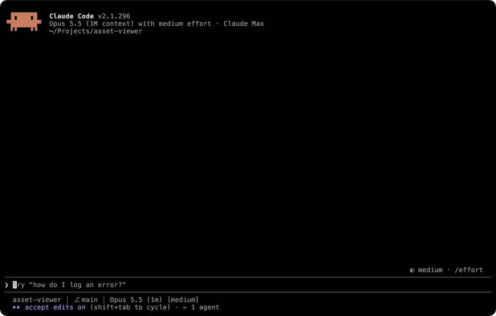

# asset-viewer

A Claude Code plugin that shows PDFs, slides, spreadsheets and images inline, right in the conversation.

Claude Code can read a PDF or a screenshot, but you never see it. With this plugin Claude puts the page under its message, so when it talks about the chart on slide 12 you're looking at slide 12 too. Reading an image or PDF shows a small preview on its own, and `/view <path>` opens a viewer you can page through from the keyboard.



## Install

In Claude Code:

```
/plugin install asset-viewer --marketplace matteo-psnt/asset-viewer
```

On a Claude Code older than 2.1.275, add the marketplace first with `/plugin marketplace add matteo-psnt/asset-viewer`, then run `/plugin install asset-viewer@asset-viewer`.

The plugin turns files into pictures with a few command-line tools. On macOS:

```
brew install poppler librsvg imagemagick
brew install --cask libreoffice
```

On Debian or Ubuntu:

```
sudo apt install poppler-utils librsvg2-bin imagemagick libheif1 unzip
sudo apt install libreoffice-writer libreoffice-impress libreoffice-calc libreoffice-math
```

LibreOffice is the big download, and it's only for Word, PowerPoint and Excel files. On Linux those won't open without it. On macOS the plugin falls back to Quick Look and headless Chrome, which gets every page but only roughly the right layout, and it loses equations.

To check what you have and whether your terminal can show pictures, run `sh bin/doctor.sh` from the plugin's folder.

## Terminals

Claude Code only draws pictures in [Ghostty](https://ghostty.org) and [kitty](https://sw.kovidgoyal.net/kitty/) 0.28 or newer. It decides by asking the terminal its name, so iTerm2 and Rio get turned away even though they draw the pictures fine. You can tell Claude Code to skip that check by adding this to `~/.claude/settings.json` and restarting it:

```json
{
  "env": { "CLAUDE_CODE_FORCE_TERMINAL_IMAGES": "1" }
}
```

The same setting turns pictures on in Claude Agents sessions (the ones you open with `<<`), which have them off by default. It applies everywhere you run Claude Code, though, so if you also use a terminal that can't draw pictures you'll see stray characters there. In that case set it in the one terminal's profile instead.

| Terminal | Pictures |
| --- | --- |
| Ghostty, kitty 0.28+ | Yes |
| iTerm2, Rio, Claude Agents sessions | With the setting above |
| Warp, WezTerm, Konsole, VS Code | No. They draw kitty images but not the placeholders Claude Code uses |
| Terminal.app, Alacritty, Windows Terminal, foot | No kitty graphics |
| tmux, screen | No. Claude Code doesn't send pictures through them |

I tested Ghostty, iTerm2 3.7.4, Rio 0.5.28, Warp, Terminal.app and Claude Agents on macOS. The other rows come from each terminal's docs.

Where pictures can't show, the preview is a short notice saying why and what would fix it, with a button to open the file in its own app. Claude gets the same message, so it describes the file in words instead.

Over ssh and under WSL the terminal can't read this machine's files, so the plugin sends the picture's bytes instead. If it guesses wrong, set "Image transport" to `bytes` or `file` in `/config`. Native Windows, the desktop app and the VS Code extension aren't supported.

## What it opens

| Type | How |
| --- | --- |
| PDF | Any page, with paging |
| Word, PowerPoint, Excel, RTF, OpenDocument | Every page or slide, converted to PDF once and cached |
| PNG, JPEG, HEIC, AVIF, WebP, TIFF, BMP, PSD, camera RAW | `sips` on macOS, ImageMagick on Linux (HEIC there needs libheif) |
| Animated GIF and WebP | Plays with the file's own timing |
| SVG | Drawn on white with `rsvg-convert` |
| Keynote, Pages, Numbers | First page only, since that's all the file's own preview holds |

Text files like code, Markdown and CSV aren't previewed, since Claude Code already shows them.

## Using it

Ask for it in plain words, like "show me slide 12 of the lecture" or "open my report in the viewer". Claude also uses it on its own when a picture would help, say after it makes a plot.

Each preview is a card with the file's name and page count, and controls under the picture to turn the page, replay an animation, open the viewer, or open the file in its own app. Clicking them needs a terminal that reports mouse clicks to Claude Code, which fullscreen mode does.

The viewer shows one page large with the pages around it in a sidebar. While it's open, `↑` and `↓` (or `p` and `n`) turn pages, `o` opens the file in its own app, and `Esc` closes it. Clicking a page in the sidebar jumps there.

## How it works

`bin/render.sh` turns a file into a PNG, or a folder of frames for an animation, and caches it under `~/Library/Caches/asset-viewer` (`~/.cache/asset-viewer` on Linux) by path, modification time and page. It renders the next page ahead of time, so paging forward is instant.

`hooks/register.tsx` is the plugin itself, a Claude Code hooks module. It registers the `preview` tool and `/view`, draws each preview in place of the tool's output, and plays animations by swapping the picture on a timer. Previews are saved, so a resumed conversation shows them again.

## Developing

```
git clone https://github.com/matteo-psnt/asset-viewer
claude plugin marketplace add ./asset-viewer
claude plugin install asset-viewer@asset-viewer
```

A marketplace added from a folder reads from that folder, so your edits load after `/reload-plugins`. Before sending a change, run:

```
claude plugin validate .
claude plugin test .
sh tests/converter.sh
```

The first two check the hooks module against Claude Code. The last runs the converter over `tests/fixtures`, and CI runs it on macOS and Ubuntu.

The plugin API this uses is in early access, so a Claude Code update can break it.

## License

MIT
