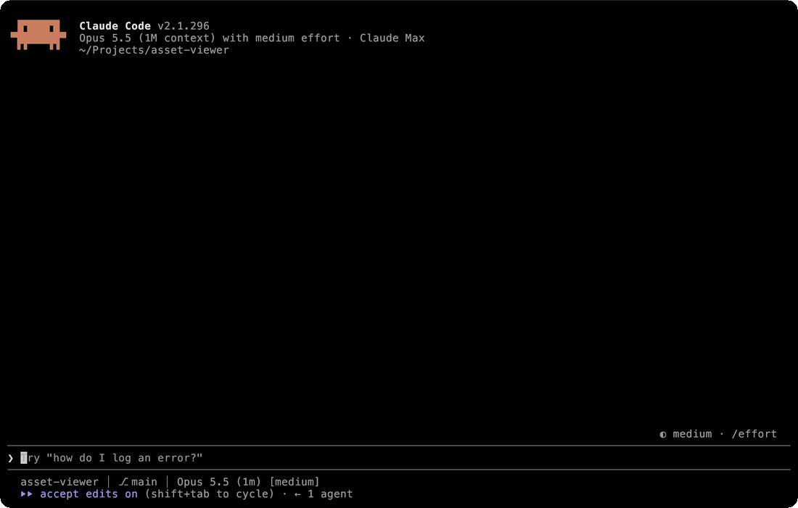

# file-viewer

[](https://github.com/matteo-psnt/file-viewer/actions/workflows/ci.yml)
[](https://github.com/matteo-psnt/file-viewer/releases)
[](LICENSE)

A Claude Code plugin that shows PDFs, slides, spreadsheets and images inline, right in the conversation.

Claude Code can read a PDF or a screenshot, but you never see it. With this plugin Claude puts the page under its message, so when it talks about the chart on slide 12 you're looking at slide 12 too. You can also open any file yourself with `/view <path>`.



## Install

In Claude Code:

```
/plugin install file-viewer --marketplace matteo-psnt/file-viewer
```

Then install the converters. On macOS:

```
brew install poppler librsvg imagemagick
brew install --cask libreoffice
```

On Debian or Ubuntu:

```
sudo apt install poppler-utils librsvg2-bin imagemagick libheif1 unzip
sudo apt install libreoffice-writer libreoffice-impress libreoffice-calc libreoffice-math
```

LibreOffice is only for Word, PowerPoint and Excel. Without it, macOS falls back to Quick Look, which gets every page but only roughly the right layout, and Linux can't open them at all.

`sh scripts/doctor.sh`, run from the plugin's folder (`plugin/` in this repo), tells you what's missing and whether your terminal can show pictures.

## Terminals

Claude Code only draws pictures in [Ghostty](https://ghostty.org) and [kitty](https://sw.kovidgoyal.net/kitty/) 0.28+. iTerm2, Rio and Claude Agents sessions (`<<`) can show them too once you add this to `~/.claude/settings.json` and restart:

```json
{
  "env": { "CLAUDE_CODE_FORCE_TERMINAL_IMAGES": "1" }
}
```

That applies everywhere you run Claude Code, so leave it out if you also use a terminal from the "Blocks" rows below; you'd see stray characters there.

| Terminal | What you see |
| --- | --- |
| Ghostty, kitty 0.28+ | The real picture |
| iTerm2 | The real picture with the setting above or [the iTerm2 helper](#real-pictures-in-iterm2), blocks without either |
| Rio, Claude Agents sessions | The real picture with the setting above, blocks without it |
| Warp, WezTerm, Konsole, VS Code | Blocks. They don't draw the placeholders Claude Code uses |
| Terminal.app, Alacritty, Windows Terminal, foot | Blocks. No kitty graphics |
| tmux, screen | Blocks. Claude Code doesn't send pictures through them |

Where pictures can't show, the page is drawn in coloured block characters, four blocks to a character cell, with a line saying why and what would show the real picture. It's rough, but you can tell the slides apart and see the charts. Claude is told you see a block preview, so it describes small text and fine detail in words. The blocks come from ImageMagick, or from `sips` on macOS; with neither, you get a notice with a button to open the file in its own app.

### Real pictures in iTerm2

iTerm2 can show the real picture without the env setting above, through iTerm2's own scripting API: a small Python helper watches the screen and draws each page over its block preview. To turn it on:

1. Run `python3 -m pip install iterm2`. `python3 -m pip install Pillow` too, if you want a page that's partly scrolled off the screen drawn as well.
2. In iTerm2, turn on **Settings > General > Magic > Enable Python API**.
3. Start a new Claude Code session.

The helper runs only in iTerm2, only while pictures would otherwise be blocks, and stops with the session. If it can't start, previews stay blocks and Claude Code's debug log says why. To see each draw it makes, start `claude` with `FILE_VIEWER_DEBUG=/tmp/overlay.log`. It's ported from [inline-images](https://github.com/chrisns/claude-image-cli-mod); see [THIRD_PARTY_NOTICES.md](plugin/THIRD_PARTY_NOTICES.md).

If you've set `CLAUDE_CODE_FORCE_TERMINAL_IMAGES` and a terminal you also use can't draw pictures, Claude Code sends them anyway and you get blank cards or stray characters. Leave the setting out to get blocks there.

Click a picture to open the file in its own app. On a page of a deck or PDF shown inline, a click opens the viewer on that page instead, and in the viewer a click on a thumbnail turns to it. Over ssh and under WSL the plugin sends picture bytes instead of file paths; if that guess is wrong, change "Image transport" in `/config`.

## What it opens

| Type | How |
| --- | --- |
| PDF | Any page, with paging |
| Word, PowerPoint, Excel, RTF, OpenDocument | Every page or slide, converted once and cached |
| PNG, JPEG, HEIC, AVIF, WebP, TIFF, BMP, PSD, camera RAW | `sips` on macOS, ImageMagick on Linux |
| Animated GIF and WebP | Plays with the file's own timing |
| SVG | Drawn with `rsvg-convert` |
| Keynote, Pages, Numbers | First page only |

Text files aren't previewed, since Claude Code already shows them.

## Using it

Ask in plain words, like "show me slide 12 of the lecture" or "open my report in the viewer". Claude also uses it on its own when a picture would help, say after it makes a chart.

When Claude sends you a file, say a report or a deck it just made, its first page shows under the delivery. A file sent as a download only (`display: "attach"`) stays a download.

In the viewer, `↑`/`↓` or `p`/`n` turn pages, `o` opens the file in its own app and `Esc` closes it. The keys work while the viewer has the keyboard; `ctrl+x tab` gives it back after you've typed in the prompt.

Everything runs on your machine, and the plugin never uploads your files. See [PRIVACY.md](PRIVACY.md).

## What it runs, reads, writes and sends

**Programs.** Turning a file into a picture runs local converters with the file's path as an argument, through the scripts in `plugin/scripts/`:

- `render.sh`: `sips` and `qlmanage` on macOS, ImageMagick (`magick` or `convert`), poppler (`pdftoppm`, `pdfinfo`, `pdfseparate`, `pdfunite`), `rsvg-convert`, LibreOffice (`soffice`) for Office files and `unzip` for iWork previews. Without LibreOffice on macOS, Quick Look's HTML is printed to a PDF by a headless Chrome, Chromium, Edge or Brave that loads only that local file.
- `cells.sh` (ImageMagick or `sips`) scales a page for the coloured-block preview, `jpeg.sh` (`sips` or ImageMagick) makes the smaller JPEG the desktop app shows, and `cell.sh` (`ps`, `perl`) asks the terminal its size in pixels to measure a character cell.
- `open.sh` opens a file in its own app with `open`, `wslview` or `xdg-open` when you press "open".
- In iTerm2 only, `iterm_overlay.py` (`python3`) uses iTerm2's local Python API to lay real pictures over the block previews.

**What it reads.** The files you or Claude ask to preview, and the environment variables `TERM_PROGRAM`, `ITERM_SESSION_ID`, `SSH_CONNECTION`, `SSH_TTY` and `WSL_DISTRO_NAME`, to choose how pictures reach the terminal. None of these are credentials, and none leave your machine.

**What it writes.** Rendered pages go to a cache only you can read (`~/Library/Caches/claude-file-viewer` on macOS, `$XDG_CACHE_HOME/claude-file-viewer` elsewhere), along with the overlay's notes in its `overlays/` folder. Anything unused for 30 days is deleted. It writes nothing else.

**What it sends.** Nothing over the network. Pictures go only to your terminal, and to the Claude Code desktop app or editor when you use those.

**Hooks.** The plugin adds the `preview` tool and its own `/view` command, and answers calls of its own `preview` tool. It draws its own tool results, the viewer pane and a preview under a file Claude sends you (leaving that tool's own result as it was), keeps the arrow keys on the viewer's thumbnails while the viewer has focus, and opens a file or turns a page when you click a picture. It does not read or change other tools' calls, your settings or your instructions.

The plugin API this uses is in early access, so a Claude Code update can break it.

## License

MIT
